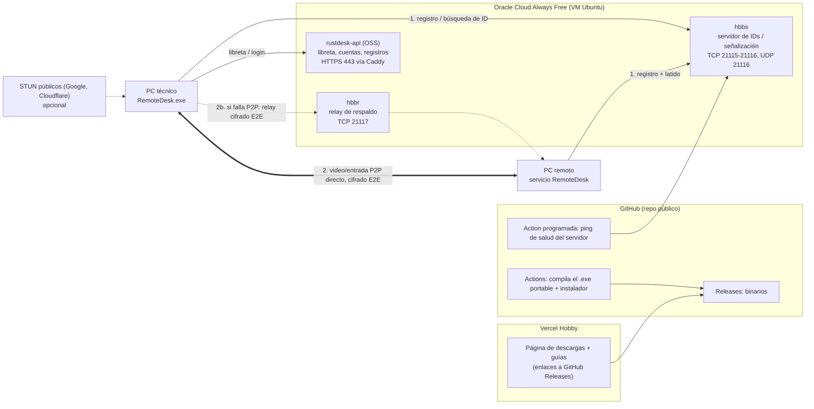

# Arquitectura — RemoteDesk (nombre provisional)

> Estado: **propuesta, pendiente de aprobación**. Fecha: 2026-11-16.
> El nombre "RemoteDesk" es provisional; se cambia en un solo lugar (ver CLAUDE.md).

## 1. Requisitos confirmados

| Tema | Decisión |
|---|---|
| Uso | Soporte interno Kardinc / PCs propios. **1 PC al principio, máximo 2-3.** |
| Plataforma | Windows 10/11 (controlado y controlador). |
| Ruta técnica | **Fork de RustDesk** (AGPL-3.0), con nombre e iconos propios y nuestro servidor ya configurado. |
| Repositorio | **GitHub público**: builds de Actions ilimitados y cumplimiento de la AGPL. |
| Tarjeta | Disponible **solo para verificar identidad** (Oracle). Nunca para servicios que cobren por uso. |
| Costo | **$0**. |

## 2. Por qué un fork de RustDesk y no empezar de cero

| Criterio | Fork de RustDesk | Desde cero (Tauri + WebRTC) |
|---|---|---|
| Costo | $0 | $0 |
| Tiempo hasta paridad con AnyDesk | Semanas (casi todo ya existe) | Muchos meses |
| Captura DXGI, códecs HW (NVENC/QSV/AMF), H.264/H.265/VP9/AV1 | Ya incluido | Por construir |
| Servicio de Windows, pantalla de login, UAC, Ctrl+Alt+Supr | Ya incluido y probado en millones de equipos | Lo más difícil del proyecto |
| Archivos, portapapeles, audio, chat, privacidad, multimonitor, pestañas, 2FA | Ya incluido | Por construir |
| Riesgo | Bajo | Alto (estabilidad y fluidez, que son la prioridad n.º 1) |

**Qué implica la AGPL-3.0:**
- Si entregas el binario a alguien, también debes ofrecerle el código fuente con tus cambios, bajo la misma licencia. Con el repositorio público esto se cumple automáticamente.
- Hay que conservar los avisos de copyright y licencia de RustDesk.
- **No** se pueden usar el nombre ni el logo de "RustDesk" como si fueran nuestros. Por eso cambiamos el nombre y los iconos.
- Los secretos (la clave privada del servidor y las contraseñas) **nunca** van al repositorio. La clave pública del servidor sí puede ir, porque es pública.

**Diferencias frente a la especificación original (hay que aceptarlas):**
1. **El transporte no es WebRTC.** RustDesk usa su propio protocolo: perforación NAT por UDP/TCP (P2P directo) y, si falla, su relay `hbbr`. El cifrado es de extremo a extremo con NaCl (Curve25519 + XSalsa20-Poly1305) y la identidad del servidor se verifica con su clave pública. Es igual de seguro que DTLS/SRTP y ya está optimizado para escritorio remoto.
2. **La interfaz es Flutter, no Tauri.** Se compila con Actions igual que el resto.
3. **No hace falta TURN de Cloudflare ni Supabase.** `hbbr` es el relay y la libreta de direcciones vive en el mismo servidor (ver §4).

## 3. Diagrama

## 4. Servicios gratuitos elegidos y sus límites

| Servicio | Para qué | Límite gratuito (verificado 2026-11) | Si se supera |
|---|---|---|---|
| **Oracle Cloud Always Free** (VM AMD `E2.1.Micro` o Ampere A1) | `hbbs` + `hbbr` + `rustdesk-api` + Caddy (HTTPS) | 2 VM AMD micro (1/8 OCPU, 1 GB). Ampere A1: 4 OCPU/24 GB según la doc de Oracle; fuentes de 2026 dicen que bajó a 2 OCPU/12 GB (lo confirmo en la consola al crear la VM). **10 TB/mes de salida.** | En una cuenta *Always Free* (sin pasar a pago por uso) Oracle **no cobra**: bloquea el recurso. **Nunca haremos "Upgrade to Pay As You Go".** |
| **GitHub** (repo público, Actions, Releases) | Código, CI de Windows, descargas | Actions ilimitado en repos públicos; Releases sin límite práctico (máx. 2 GB por archivo) | No aplica |
| **Vercel Hobby** | Página de descargas y guías (sitio estático) | 100 GB/mes de transferencia; solo uso no comercial | Se pausa el sitio; los binarios siguen en GitHub Releases |
| **STUN público** (`stun.l.google.com:19302`, `stun.cloudflare.com`) | Ayuda a descubrir la IP pública (opcional; `hbbs` ya cumple esa función) | Gratis, sin límite | No aplica |
| ~~Supabase~~ | **Descartado** | Se pausa tras 7 días sin uso y no lo necesitamos para 5 PCs | — |
| ~~Cloudflare TURN~~ | **Descartado** | 1.000 GB/mes gratis, pero cobra $0,05/GB de más con tarjeta registrada | Riesgo de cobro → lo reemplaza `hbbr` |

**Consumo estimado:** 1 a 3 PCs con tráfico mayormente P2P. Si una sesión 1080p/30 fps (unos 3 Mbps) fuera **siempre** por relay, gastaría ~1,35 GB/hora: 7.000 horas al mes antes de tocar el límite de 10 TB. Sobra margen.

### Riesgo principal: Oracle recupera VMs inactivas
Oracle puede reclamar instancias *Always Free* inactivas durante 7 días (CPU p95 < 20 %, red < 20 % y, en A1, memoria baja). Mitigaciones:
1. **Uso la VM AMD `E2.1.Micro`.** Tiene CPU tan pequeña que el uso normal del servidor la mantiene activa más fácilmente que una A1.
2. **Reconstrucción en 10 minutos:** script `infra/` (cloud-init + docker compose) en el repo. Las **claves del servidor** se respaldan fuera del repo (en tu PC o gestor de contraseñas), así una VM nueva conserva la misma identidad y los clientes no se reconfiguran.
3. **Dominio o DNS fijo** (ver §7): si cambia la IP, solo se actualiza el DNS.
4. **Una Action programada de GitHub** comprueba cada hora que el servidor responde y abre un *issue* (que te llega por correo) si se cae.
5. **Plan B gratuito:** en la misma red local, RustDesk se conecta por IP directa sin servidor.

## 5. Modelo de seguridad

| Amenaza | Control |
|---|---|
| Espionaje del tráfico | Cifrado E2E de RustDesk (NaCl). El servidor y el relay **no ven** el contenido. |
| Servidor suplantado | Clave pública de `hbbs` incrustada en el binario; si no coincide, no conecta. |
| Terceros usando nuestro servidor | `hbbs`/`hbbr` exigen la clave (`-k`); clientes ajenos no pueden registrarse ni usar el relay. |
| Fuerza bruta | Límite de intentos de RustDesk + contraseña permanente fuerte + **2FA TOTP** (nativo de RustDesk). La contraseña permanente ya se guarda con hash y sal (`hbb_common/src/config/permanent_password`). En la Fase 4 reviso el algoritmo y, si no es un KDF lento, lo cambio a Argon2. |
| Acceso no autorizado | Modo "solo contraseña permanente" o "aprobar manualmente", **lista blanca de IP**, desactivar descubrimiento LAN para extraños. |
| Sesión oculta | Ventana/indicador de sesión **siempre visible** en el remoto con botón de desconectar (comportamiento nativo; verifico que no se pueda ocultar en el build). |
| Auditoría | Registro de conexiones local (quién, cuándo, IP) + registros centralizados en `rustdesk-api`. |
| Superficie del servidor | Firewall de Oracle: solo 21115-21117 TCP, 21116 UDP y 443. SSH solo con clave y `fail2ban`. Actualizaciones automáticas de seguridad. |
| Binarios alterados | Builds reproducibles en Actions + SHA-256 publicado en cada Release. |

### SmartScreen y antivirus (sin certificado pagado)
- **Opción gratuita de firma: [SignPath Foundation](https://signpath.org).** Firma gratis proyectos open source con builds en GitHub Actions. Como el repo será público y AGPL, **aplicamos**. Requiere aprobación manual (días o semanas) y que el proyecto esté activo.
- Mientras tanto: enviar cada Release al [portal de Microsoft](https://www.microsoft.com/wdsi/filesubmission) como falso positivo (gratis). SmartScreen gana reputación con el tiempo y las descargas.
- Guía para el usuario: "Más información → Ejecutar de todos modos" y, si hace falta, una exclusión del antivirus (solo en equipos propios).
- Nota: las herramientas de acceso remoto suelen marcarse como *PUA/RemoteAdmin*. Es normal y se documenta.

## 6. Plan por fases (ajustado al fork)

| Fase | Contenido | Criterio de "hecho" |
|---|---|---|
| **0** | Este documento + CLAUDE.md | Tu aprobación |
| **1 — Núcleo** | **1a (lista):** VM Oracle + `hbbs`/`hbbr` (`infra/`), y `tools/make-portable.ps1`, que toma el cliente oficial 1.5.3 (SHA-256 verificado) y le incrusta servidor y clave en el nombre del .exe, mecanismo nativo verificado en `src/custom_server.rs`. Sirve para probar ya la conexión y el rendimiento, sin compilar. **1b:** fork en GitHub con un paso de CI que parchea `RENDEZVOUS_SERVERS`, `RS_PUB_KEY` y `APP_NAME` (`hbb_common/src/config.rs`), más el nombre y los iconos, y genera `RemoteDesk.exe`. Requiere el nombre definitivo. | En un PC limpio: ver y controlar en LAN y por internet (hotspot móvil); indicador Directa/Relay; medir latencia/FPS (objetivo ≤60 ms LAN, ≤150 ms internet); costo $0 |
| **2 — Robustez** | Instalador (`RemoteDesk-Setup.exe`/MSI) con servicio, acceso desatendido, login/UAC, reconexión tras corte y reinicio, relay forzado probado, multimonitor, HW encoding verificado | Prueba de reinicio remoto y corte de red; sesión por relay estable |
| **3 — Productividad** | Verificar y ajustar portapapeles, archivos (reanudación), audio, chat, pestañas; `rustdesk-api` con libreta, favoritos y en línea/fuera | Lista de verificación funcional completa |
| **4 — Web + seguridad** | Página de descargas en Vercel, 2FA, lista blanca, registros centralizados, endurecimiento del servidor, Action de salud | Prueba de fuerza bruta bloqueada; registros visibles |
| **5 — Pulido** | Tema y idiomas (ES/EN ya existen; reviso textos), presets Calidad/Equilibrado/Velocidad, CI completo, solicitud a SignPath, guías en español | Release v1.0 publicada |
| **6 (opcional) — Wake-on-LAN** | Verificar el soporte WOL de RustDesk (versiones recientes lo traen) o agregar el reenvío por un agente encendido + asistente de BIOS/Windows | Encender un PC apagado desde fuera |

## 7. Lo que necesito de ti para empezar la Fase 1
1. **Nombre definitivo** del producto (y, si tienes, un logo o ícono).
2. Crear una **cuenta en Oracle Cloud** (región cercana, por ejemplo Bogotá o São Paulo; la región **no se puede cambiar** después). Te guío paso a paso.
3. Tu **usuario de GitHub** para crear el fork.
4. ¿Tienes un **dominio**? Si no, uso uno gratis de DuckDNS o la IP fija reservada de Oracle (también gratis).
5. Un **segundo PC** y un **celular con hotspot** para las pruebas reales.
